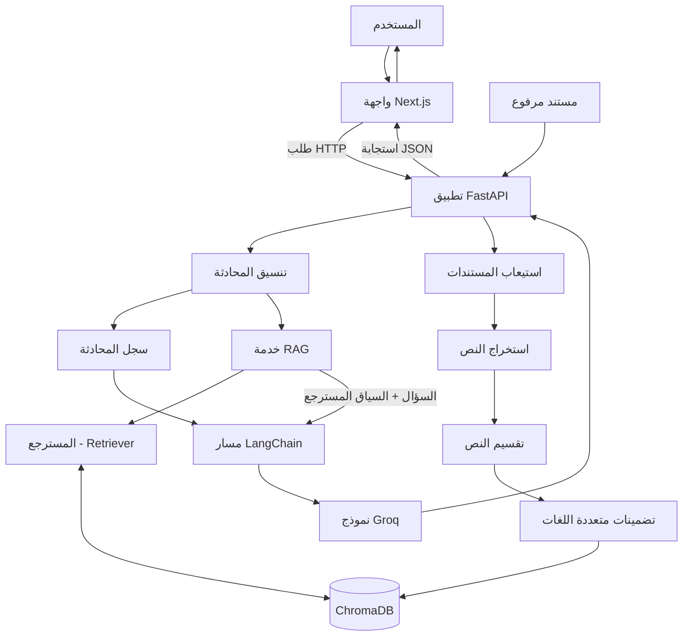
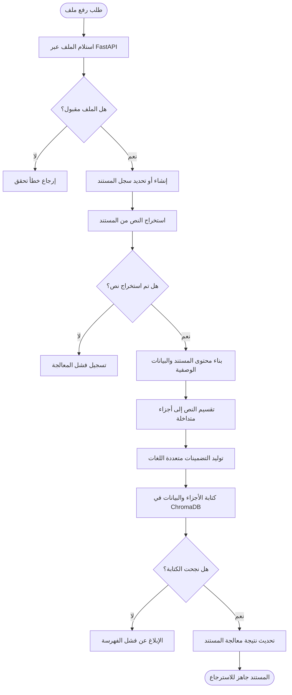
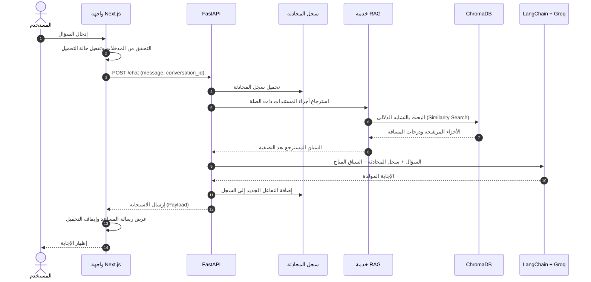
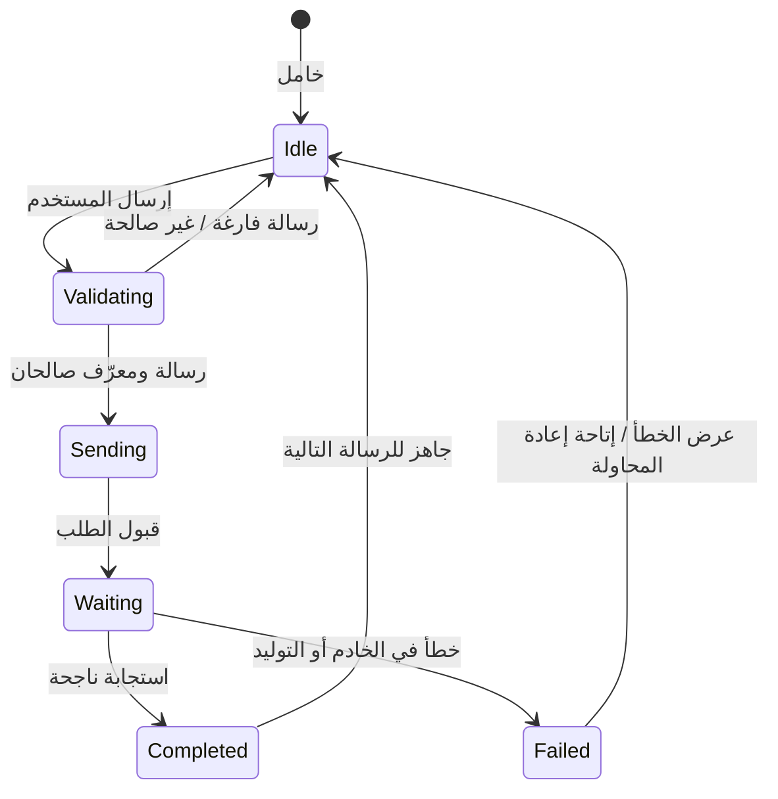
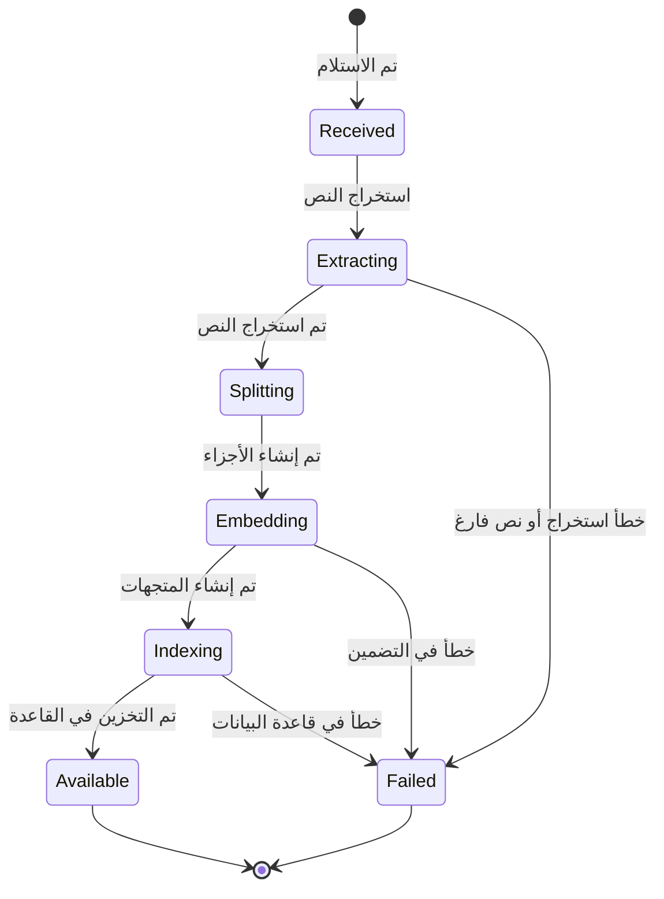
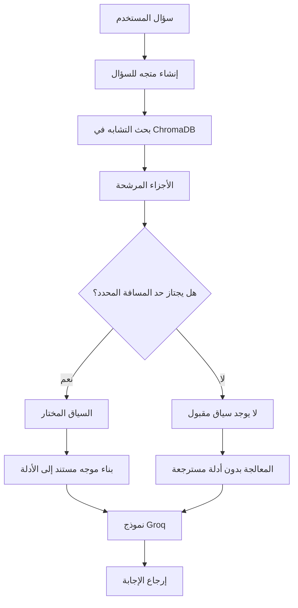

# اسك دوكس للذكاء الاصطناعي (AskDocs AI)

**تطبيق محادثة ذكي ثنائي اللغة مدعوم بتقنية التوليد المعزز بالاسترجاع (RAG) للاستعلام من مستنداتك الخاصة.**

[](https://nextjs.org/)
[](https://react.dev/)
[](https://fastapi.tiangolo.com/)
[](https://www.langchain.com/)
[](https://www.trychroma.com/)

> **حالة المشروع:** قيد التطوير النشط / مشروع تعليمي
> **الترخيص:** لم يُحدد بعد

**AskDocs AI** هو تطبيق متكامل (Full-stack) قابل للتشغيل محلياً. تصف الشارات أعلاه التقنيات الأساسية المستخدمة في بناء المشروع، ولا تمثل حالة البناء (Build Status) أو الإصدار الرسمي.

---

## جدول المحتويات

- [حول المشروع](#حول-المشروع)
- [الميزات الرئيسية](#الميزات-الرئيسية)
- [التقنيات والمكتبات المستخدمة](#التقنيات-والمكتبات-المستخدمة)
- [المعمارية وهيكلة المشروع](#المعمارية-وهيكلة-المشروع)
- [آلية العمل](#آلية-العمل)
- [البنية الداخلية للنظام وتدفق العمليات من البداية للنهاية](#البنية-الداخلية-للنظام-وتدفق-العمليات-من-البداية-للنهاية)
  - [1. المعمارية عالية المستوى للمكونات](#1-المعمارية-عالية-المستوى-للمكونات)
  - [2. دورة حياة استيعاب المستندات (Ingestion)](#2-دورة-حياة-استيعاب-المستندات-ingestion)
  - [3. دورة حياة السؤال والإجابة](#3-دورة-حياة-السؤال-والإجابة)
  - [4. حالة المحادثة (Conversation State)](#4-حالة-المحادثة-conversation-state)
  - [5. حالات معالجة المستندات](#5-حالات-معالجة-المستندات)
  - [6. الاسترجاع واختيار السياق](#6-الاسترجاع-واختيار-السياق)
  - [7. مسارات الفشل والسياق الفارغ](#7-مسارات-الفشل-والسياق-الفارغ)
- [واجهة برمجة التطبيقات (API Boundary)](#واجهة-برمجة-التطبيقات-api-boundary)
- [ملاحظات تشغيلية والحدود الحالية](#ملاحظات-تشغيلية-والحدود-الحالية)
- [المساهمة في المشروع](#المساهمة-في-المشروع)
- [الترخيص](#الترخيص)

---

## حول المشروع

**اسك دوكس للذكاء الاصطناعي (AskDocs AI)** هو تطبيق محادثة ذكي ثنائي اللغة (العربية والإنجليزية) يجمع بين الذكاء الاصطناعي التحاوري وتقنية **التوليد المعزز بالاسترجاع (Retrieval-Augmented Generation - RAG)**. صُمم التطبيق لتمكين المستخدمين من رفع المستندات المدعومة وطرح الأسئلة حول محتواها باستخدام اللغة الطبيعية.

قد تجيب النماذج اللغوية العامة من واقع بيانات تدريبها المسبقة فقط، وهو ما يكون غير كافٍ عندما يتعلق السؤال بسياسة شركة محددة، أو دليل داخلي، أو مستند خاص يقدمه المستخدم. تعالج تقنية **RAG** هذه المشكلة عن طريق استرجاع المقاطع ذات الصلة من مجموعة مستندات المستخدم وتمريرها كسياق (Context) للنموذج اللغوي عند توليد الإجابة.

يجمع المشروع بين واجهة ويب حديثة، وواجهة برمجة تطبيقات بلغة Python، وتكامل مع مزود نماذج لغوية كبيرة (LLM)، واستخراج النصوص من المستندات، والتضمينات متعددة اللغات (Multilingual Embeddings)، وقاعدة بيانات متجهة دائمة (Persistent Vector Store).

### أهداف المشروع

- توفير تجربة محادثة سلسة ومباشرة باللغتين العربية والإنجليزية.
- تمكين المستخدمين من الاستعلام عن المعلومات الواردة في مستنداتهم المرفوعة.
- تأسيس الإجابات المعتمدة على المستندات بناءً على المحتوى المسترجع بدلاً من الاعتماد فقط على المعرفة العامة للنموذج.
- الحفاظ على استقلالية المكونات (الواجهة الأمامية، الواجهة الخلفية، تكامل النماذج، وآليات الاسترجاع) بحيث يمكن تطوير كل جزء منها بشكل منفصل.

---

## الميزات الرئيسية

- **تفاعل ثنائي اللغة:** مصمم للتعامل مع الأسئلة ومحتوى المستندات باللغتين العربية والإنجليزية.
- **محادثة تفاعلية:** واجهة مستخدم مبنية بـ Next.js متصلة بواجهة خلفية مبنية بـ FastAPI.
- **تكامل النماذج اللغوية (LLM):** يستخدم تكامل Groq عبر مكتبة LangChain لتوليد ردود فائقة السرعة.
- **الأسئلة والأجوبة المستندة إلى الوثائق:** استرجاع المقاطع النصية ذات الصلة قبل صياغة إجابات RAG.
- **استخراج النصوص العربية من ملفات PDF:** يعتمد على مكتبة `PDF2Text-Arabic` لمعالجة تخطيط النصوص العربية بدقة (مع تعطيل خيار التعرف الضوئي على الحروف OCR في الإعدادات الحالية).
- **تضمينات متعددة اللغات (Multilingual Embeddings):** يستخدم نموذج `sentence-transformers/paraphrase-multilingual-MiniLM-L12-v2` عبر تكامل Hugging Face في LangChain.
- **البحث المتجه (Vector Search):** تخزين والبحث في تضمينات المستندات داخل مجموعة دائمة في قاعدة بيانات **ChromaDB**.
- **سياق المحادثة (Conversation Context):** ربط طلبات المحادثة بمعرّف محادثة (`conversation_id`) وإدارة سجل الرسائل عبر LangChain.
- **واجهة إدارة المستندات:** تتضمن قسمًا مخصصًا لإدارة الملفات في الواجهة الأمامية.
- **توثيق تفاعلي للـ API:** يوفر FastAPI توثيقًا تفاعليًا تلقائيًا عبر المسار `/docs` أثناء تشغيل الخادم.

> **ملاحظة:** يُنصح بالتحقق من أنواع الملفات المدعومة ومسارات إدارة المستندات الدقيقة من خلال الكود المصدري الحالي للواجهة الخلفية وصفحة `/docs`.

---

## التقنيات والمكتبات المستخدمة

### الواجهة الأمامية (Frontend)

| التقنية | الغرض من الاستخدام |
| :--- | :--- |
| **Next.js 16** | إطار عمل React، إدارة المسارات (Routing)، وبناء تطبيق الويب |
| **React 19** | بناء واجهة المستخدم المعتمدة على المكونات (Components) |
| **TypeScript** | الكتابة الساكنة (Static Typing) لضمان جودة كود الواجهة الأمامية |
| **Tailwind CSS 4** | تنسيق الواجهات بسرعة ومرونة (Utility-first styling) |
| **`react-markdown`** | عرض تنسيقات Markdown داخل رسائل المحادثة |
| **`remark-gfm`** | دعم صيغة GitHub Flavored Markdown (الجداول والقوائم) |

### الواجهة الخلفية والذكاء الاصطناعي (Backend & AI)

| التقنية / المكتبة | الغرض من الاستخدام |
| :--- | :--- |
| **Python** | لغة البرمجة الأساسية للواجهة الخلفية |
| **FastAPI** | بناء واجهة برمجة التطبيقات (HTTP API) ومعالجة الطلبات |
| **Uvicorn** | خادم ASGI لتشغيل التطبيق في بيئة التطوير |
| **LangChain Core** | إدارة القوالب (Prompts)، التسلسلات (Runnables)، سجل المحادثة، وتحليل المخرجات |
| **`langchain-groq`** | الربط مع نماذج المحادثة عبر منصة Groq |
| **`langchain-community`** | أدوات تحميل المستندات (Loaders) للملفات النصية وملفات PDF |
| **`langchain-huggingface`** | التكامل مع نماذج التضمين من Hugging Face |
| **`sentence-transformers`** | تحويل النصوص إلى متجهات دلالية متعددة اللغات |
| **`langchain-text-splitters`** | تقسيم النصوص المستخرجة إلى أجزاء (Chunks) قابلة للاسترجاع |
| **ChromaDB** | قاعدة بيانات متجهة دائمة (Persistent Vector Database) |
| **`langchain-chroma`** | ربط LangChain مع قاعدة بيانات ChromaDB |
| **PDF2Text-Arabic** | استخراج النصوص من ملفات PDF مع مراعاة اتجاه وتنسيق اللغة العربية |
| **pypdf** | دعم إضافي لمعالجة ملفات PDF |

### التخزين (Storage)

- **ChromaDB:** تحفظ أجزاء المستندات وتضميناتها المتجهة محليًا في مجلد `chroma_db` داخل الواجهة الخلفية.
- **ملفات المستندات والسجل:** تحتوي الواجهة الخلفية على مساحة مخصصة للملفات المرفوعة وبياناتها الوصفية (Metadata)، ويتم استبعاد هذه البيانات التشغيلية عمدًا من نظام التحكم بالإصدارات (Git).

---

## المعمارية وهيكلة المشروع

يتبع مشروع **AskDocs AI** حاليًا **معمارية أحادية معيارية (Modular Monolithic Architecture)**؛ حيث توجد الواجهة الأمامية والواجهة الخلفية كتطبيقين منفصلين داخل مستودع واحد (Monorepo)، بينما تُنظم الواجهة الخلفية بلغة Python في وحدات برمجية مركزة تفصل بين مسارات الـ API، وخدمات الـ RAG، وتكامل النماذج اللغوية، وذاكرة المحادثة.

```text
AskDocs-ai/
├── app/                                # مسارات وصفحات Next.js
│   ├── components/                     # مكونات واجهة المستخدم القابلة لإعادة الاستخدام
│   ├── documents/                      # صفحة إدارة المستندات
│   ├── globals.css                     # ملف التنسيقات العامة
│   ├── layout.tsx                      # الهيكل الجذري للتطبيق
│   └── page.tsx                        # صفحة المحادثة الرئيسية
├── public/                             # الملفات الثابتة للواجهة الأمامية
├── backend/
│   ├── llm/
│   │   └── langchain_groq_provider.py  # إعدادات نموذج Groq، القوالب، ومسار المحادثة
│   ├── memory/
│   │   └── conversation_memory.py      # أدوات إدارة ذاكرة وسجل المحادثات
│   ├── schemas/                        # نماذج البيانات للطلبات والاستجابات (Pydantic Schemas)
│   ├── test/                           # اختبارات الواجهة الخلفية ونصوص التقييم
│   ├── documents/                      # مجلد تخزين المستندات أثناء التشغيل (مستبعد من Git)
│   ├── chroma_db/                      # مجلد قاعدة البيانات المتجهة (مستبعد من Git)
│   ├── main.py                         # نقطة انطلاق تطبيق FastAPI وتعريف المسارات
│   ├── rag_service.py                  # خدمات الاستخراج، التقسيم، التضمين، والاسترجاع
│   ├── requirements.txt                # قائمة مكتبات Python المطلوبة
│   └── .env.example                    # نموذج متغيرات البيئة للواجهة الخلفية
├── .env.example                        # نموذج متغيرات البيئة للواجهة الأمامية
├── .gitignore
├── package.json
├── package-lock.json
├── README.md                           # التوثيق باللغة الإنجليزية
└── README.ar.md                        # التوثيق باللغة العربية
```

### الوحدات البرمجية الرئيسية

- **`app/`**: مسارات وصفحات تطبيق Next.js ومكونات الواجهة الرسومية.
- **`backend/main.py`**: إنشاء تطبيق FastAPI، إعداد البرمجيات الوسيطة (Middleware)، وتعريف نقاط النهاية (Endpoints).
- **`backend/rag_service.py`**: إدارة دورة حياة المستندات من استخراج النص، التقسيم، التضمين، التخزين في قاعدة البيانات المتجهة، والاسترجاع.
- **`backend/llm/langchain_groq_provider.py`**: تهيئة نموذج المحادثة من Groq وبناء سلسلة المعالجة في LangChain.
- **`backend/memory/conversation_memory.py`**: توفير الدعم لحفظ واسترجاع سياق المحادثات السابقة.
- **`backend/schemas/`**: تعريف هياكل البيانات المهيكلة المستخدمة في تبادل البيانات.
- **`backend/test/`**: يحتوي على الاختبارات البرمجية وأدوات التقييم الأولية.

---

## آلية العمل

### 1. طلب المحادثة (Chat Request)
1. يُدخل المستخدم سؤاله في واجهة المحادثة (Next.js).
2. ترسل الواجهة الأمامية نص الرسالة مع معرّف المحادثة (`conversation_id`) إلى نقطة النهاية `/chat` في FastAPI.
3. تتحقق الواجهة الخلفية من صحة الطلب وتجلب سياق المحادثة المرتبط بالمعرّف.
4. يعالج مسار النموذج اللغوي (LLM Pipeline) الطلب ويعيد الإجابة إلى الواجهة الأمامية.

### 2. استيعاب المستندات (Document Ingestion)
1. يرفع المستخدم مستندًا عبر واجهة التطبيق.
2. تستخرج الواجهة الخلفية النص من الملف (تُستخدم مكتبة `PDF2Text-Arabic` لملفات PDF مع تعطيل خيار OCR في الإعدادات الحالية).
3. يُقسّم النص المستخرج إلى أجزاء صغيرة متداخلة (Overlapping Chunks).
4. يحول نموذج التضمين متعدد اللغات كل جزء نصي إلى تمثيل متجه (Vector).
5. تُخزن الأجزاء النصية والمتجهات والبيانات الوصفية المرتبطة بها في قاعدة بيانات ChromaDB الدائمة.

### 3. الإجابة على الأسئلة باستخدام RAG
1. يطرح المستخدم سؤالاً يتعلق بمحتوى المستندات المرفوعة.
2. تحول الواجهة الخلفية السؤال إلى متجه رقمي باستخدام نفس نموذج التضمين.
3. تبحث قاعدة بيانات ChromaDB عن الأجزاء النصية الأقرب دلاليًا للسؤال.
4. تطبق طبقة الاسترجاع معيار التصفية المحدد (Distance Threshold) لاختيار المقاطع الأكثر صلة.
5. يستقبل مسار LangChain/Groq السؤال مع السياق المسترجع.
6. يولد النموذج اللغوي الإجابة ويعيدها إلى الواجهة الأمامية لعرضها للمستخدم.

```text
المتصفح (Next.js)
       |
       | طلب HTTP
       v
FastAPI (backend/main.py)
       |
       +------ إدارة المحادثة وسجل الرسائل
       |
       +------ خدمة RAG
                    |
                    +--> استخراج النص من المستند
                    +--> تقسيم النص إلى أجزاء (Chunks)
                    +--> إنشاء تضمينات متعددة اللغات (Embeddings)
                    +--> ChromaDB (قاعدة البيانات المتجهة)
                    |
                    +<-- استرجاع الأجزاء ذات الصلة
       |
       v
LangChain + Groq
       |
       v
الإجابة المولدة
       |
       v
المتصفح (Next.js)
```

---

## البنية الداخلية للنظام وتدفق العمليات من البداية للنهاية

يوضح هذا القسم كيفية تعاون مكونات التطبيق الحالية، بدءًا من تفاعل المتصفح وحتى المعالجة الخلفية، والاسترجاع، وتوليد الاستجابة.

### 1. المعمارية عالية المستوى للمكونات

ينظم التطبيق في عمليتين أساسيتين متعاونتين:
- **واجهة Next.js الأمامية:** مسؤولة عن واجهة المستخدم، إدارة حالة التفاعل في المتصفح، وإرسال طلبات HTTP.
- **واجهة FastAPI الخلفية:** مسؤولة عن التحقق من صحة البيانات، تنسيق المحادثات، معالجة المستندات، الاسترجاع، والتواصل مع النموذج اللغوي.
- **ChromaDB:** تحفظ أجزاء المستندات ومتجهاتها بشكل دائم بين جلسات التشغيل.
- **Groq:** توفر نموذج المحادثة المستخدم في مسار LangChain.
- **Hugging Face Sentence Transformers:** تنشئ تضمينات متجهة متعددة اللغات لكل من المستندات واستعلامات المستخدمين.



يُظهر المخطط أعلاه الفصل المنطقي للمسؤوليات؛ حيث يلتقي مسار استيعاب المستندات ومسار المحادثة عند قاعدة البيانات المتجهة الدائمة.

### 2. دورة حياة استيعاب المستندات (Ingestion)

تحوّل عملية الاستيعاب الملف المرفوع إلى معرفة قابلة للبحث. لا يتم إرسال الملف الأصلي مباشرة إلى النموذج اللغوي مع كل سؤال، بل يُعالج مسبقًا وتُفهرس أجزاءه النصية في ChromaDB.



#### مراحل المعالجة بالتفصيل:
1. **الاستلام (Receive):** ترسل الواجهة الأمامية الملف المختار إلى نقطة نهاية الرفع في الخادم.
2. **الاستخراج (Extract):** يُستخرج النص من ملفات PDF باستخدام `PDF2Text-Arabic` مع ضبط `ocr_strategy="never"`، مما يعني عدم اللجوء إلى التعرف الضوئي على الحروف.
3. **التوحيد والتمثيل (Normalize):** يُغلف النص المستخرج كمحتوى مستند متوافق مع LangChain مرفقًا ببياناته الوصفية.
4. **التقسيم (Split):** يستخدم `RecursiveCharacterTextSplitter` لتقسيم النص إلى أجزاء بحجم **500 حرف** وتداخل (Overlap) بمقدار **100 حرف** للحفاظ على ترابط المعنى.
5. **التضمين (Embed):** يحول نموذج `sentence-transformers/paraphrase-multilingual-MiniLM-L12-v2` كل جزء نصي إلى متجه رقمي.
6. **الفهرسة (Index):** تخزن مكتبة `langchain-chroma` الأجزاء والمتجهات داخل مجموعة ChromaDB الدائمة المسماة `company_policy_multilingual`.
7. **الإتاحة (Make available):** بعد نجاح الفهرسة، تصبح أجزاء المستند متاحة للاسترجاع في المحادثات اللاحقة.

### 3. دورة حياة السؤال والإجابة

يتبع سؤال المستخدم مسارًا مختلفًا؛ حيث تتحقق الواجهة الخلفية أولاً من وجود سياق ذي صلة في المستندات، ثم تمرر السؤال والسياق المختار إلى النموذج اللغوي.



### 4. حالة المحادثة (Conversation State)

ترتبط كل جلسة محادثة بمعرّف فريد (`conversation_id`). تُنشئ الواجهة الأمامية هذا المعرّف وتحتفظ به طوال الجلسة لترسله مع كل طلب، مما يسمح للواجهة الخلفية بتحميل وتحديث سجل الرسائل الخاص بتلك الجلسة.



### 5. حالات معالجة المستندات

يمر كل مستند منطقيًا بسلسلة من الحالات الانتقالية أثناء استيعابه، ويوضح المخطط التالي هذه الحالات ونقاط الفشل المحتملة:



> **تنويه:** تمثل هذه الحالات دورة الحياة المفاهيمية للنظام، وقد تعرض واجهة المستخدم أو سجل المستندات مجموعة مبسطة من هذه الحالات.

### 6. الاسترجاع واختيار السياق

تُعد طبقة الاسترجاع الجسر الرابط بين المعرفة المخزنة في المستندات والنموذج اللغوي.



**نقاط تصميمية جوهرية:**
- **فضاء تضمين موحد:** تستخدم المستندات والأسئلة نفس نموذج التضمين متعدد اللغات، مما يضمن إمكانية مقارنة متجهاتها بدقة.
- **الاسترجاع يسبق التوليد:** يستقبل النموذج اللغوي المقاطع المسترجعة كسياق، ولا تقوم قاعدة ChromaDB بتوليد نصوص طبيعية بنفسها.
- **التصفية حسب عتبة الصلة (Threshold Filtering):** لا تُعامل جميع نتائج البحث الأولية على أنها ذات صلة، بل تُصفى وفقًا لمعيار المسافة الدلالية المكون في خدمة RAG.

### 7. مسارات الفشل والسياق الفارغ

يوضح الجدول التالي نقاط الفشل المحتملة عبر مراحل النظام المختلفة والجهة المسؤولة عن معالجتها:

| المرحلة | مثال على الحالة | منطقة المعالجة المتوقعة |
| :--- | :--- | :--- |
| **التحقق في الواجهة الأمامية** | رسالة فارغة أو فقدان معرّف المحادثة | واجهة المحادثة (Chat UI) |
| **طلب HTTP** | تعذر الوصول للخادم أو رفض الطلب | معالجة الأخطاء في الواجهة الأمامية / FastAPI |
| **رفع الملفات** | صيغة ملف غير مدعومة أو ملف تالف | نقطة نهاية الرفع (Upload Endpoint) |
| **استخراج النصوص** | ملف PDF ممسوح ضوئيًا (صور) بدون نص قابل للاستخراج | خدمة معالجة المستندات |
| **التقسيم والتضمين** | خطأ في المعالجة أو تعطل نموذج التضمين | خدمة RAG |
| **الفهرسة المتجهة** | فشل الكتابة في قاعدة ChromaDB | خدمة RAG |
| **الاسترجاع** | عدم وجود أجزاء مطابقة أو عدم اجتياز عتبة الصلة | منطق الاسترجاع وبناء الموجه (Prompt) |
| **توليد الإجابة (LLM)** | خطأ من المزود، انتهاء المهلة (Timeout)، أو استجابة غير صالحة | تكامل LangChain / Groq |

---

## واجهة برمجة التطبيقات (API Boundary)

تُشكل **FastAPI** حدود التواصل عبر HTTP للواجهة الخلفية. المسار الرئيسي للمحادثة المستخدم حاليًا هو:

`POST /chat`

**مثال على جسم الطلب (Request Body):**

```json
{
  "message": "ما هي سياسة الإجازات السنوية؟",
  "conversation_id": "example-conversation-id"
}
```

للاطلاع على الهيكل الدقيق للاستجابات وجميع مسارات إدارة المستندات المتاحة، يرجى زيارة التوثيق التفاعلي أثناء تشغيل الخادم المحلي عبر الرابط:

```text
http://127.0.0.1:8000/docs
```

---

## ملاحظات تشغيلية والحدود الحالية

- **استخراج نصوص PDF:** يعتمد المسار الحالي على `PDF2Text-Arabic` مع تعطيل تقنية OCR. لذا فإن ملفات PDF المصورة (Scanned PDFs) التي لا تحتوي على طبقة نصية ستتطلب تفعيل أو إضافة ميزة OCR في تحديثات مستقبلية.
- **استمرارية البيانات (Persistence):** تُحفظ بيانات ChromaDB محليًا داخل مجلد التشغيل في الواجهة الخلفية. يُرجى أخذ نسخ احتياطية من هذا المجلد للحفاظ على الفهرس.
- **تغيير نموذج التضمين:** يتطلب تغيير نموذج التضمين لمجموعة بيانات موجودة إعادة فهرسة كافة المستندات؛ إذ لا يمكن خلط متجهات ناتجة عن نماذج مختلفة في نفس فضاء البحث.
- **ذاكرة المحادثات:** يعتمد التطبيق حاليًا على إدارة السجل داخل LangChain؛ يُنصح بمراجعة آلية تخزينها الدائم قبل نشر التطبيق على خوادم متعددة (Multiple Workers).
- **الأمان (Security):** قبل إتاحة التطبيق لمستخدمين خارجيين في بيئة إنتاجية، يجب إضافة طبقات المصادقة والصلاحيات (Auth)، وتحديد أحجام الملفات المرفوعة، وتطبيق حدود الطلبات (Rate Limiting)، وإعداد سياسات CORS بشكل آمن.
- **التحقق من المصادر:** قد تخطئ النماذج اللغوية أحيانًا؛ لذا يُنصح دائمًا بمراجعة المقاطع الأصلية في المستندات عند اتخاذ قرارات هامة.

---

## المساهمة في المشروع

نرحب بجميع المساهمات، وتقارير الأخطاء، والاقتراحات التطويرية:

1. انسخ المستودع إلى حسابك (Fork the repository).
2. أنشئ فرعًا جديدًا لميزتك أو إصلاحك:
   ```bash
   git checkout -b feature/your-feature
   ```
3. نفّذ تعديلاتك مع الحفاظ على تركيزها ونطاقها المحدد.
4. شغّل الاختبارات اللازمة للواجهة الأمامية والخلفية للتحقق من سلامة الكود.
5. احفظ تغييراتك برسالة واضحة:
   ```bash
   git commit -m "Add: وصف موجز للتغيير"
   ```
6. ارفع الفرع إلى مستودعك وافتح طلب سحب (Pull Request) يوضح المشكلة، الحل، وطريقة الاختبار.

> **تنبيه هام:** يُرجى التأكد من عدم تضمين مفاتيح الـ API، أو المستندات الخاصة، أو مجلدات قاعدة البيانات المحلية، أو البيئات الافتراضية (`venv` / `node_modules`) ضمن مساهماتك.

---

## الترخيص

لم يُحدد ترخيص لهذا المستودع حتى الآن. إلى أن يتم إضافة ملف ترخيص (`LICENSE`) رسمي، لا يُفترض أن المشروع متاح لإعادة الاستخدام أو التوزيع أو التعديل غير المقيد.