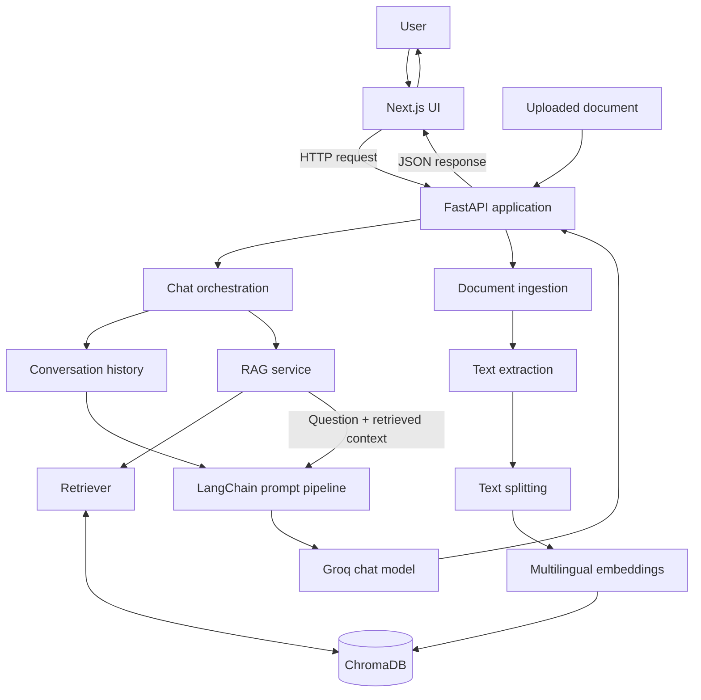
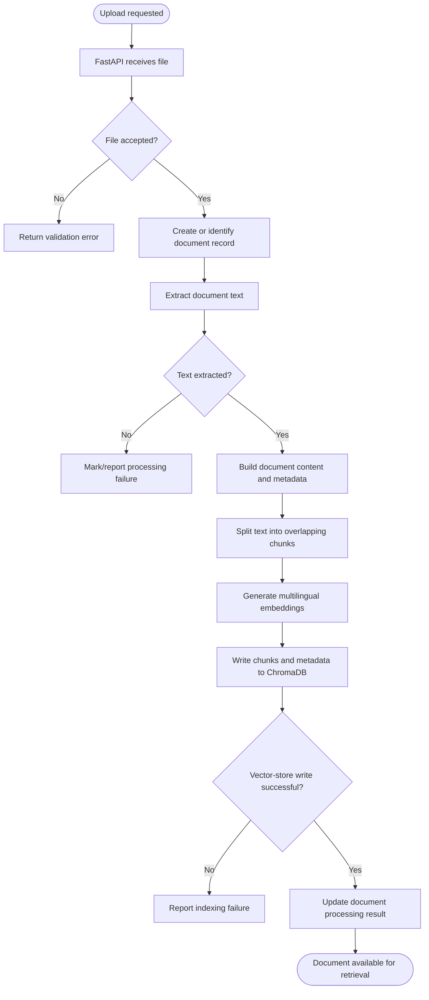
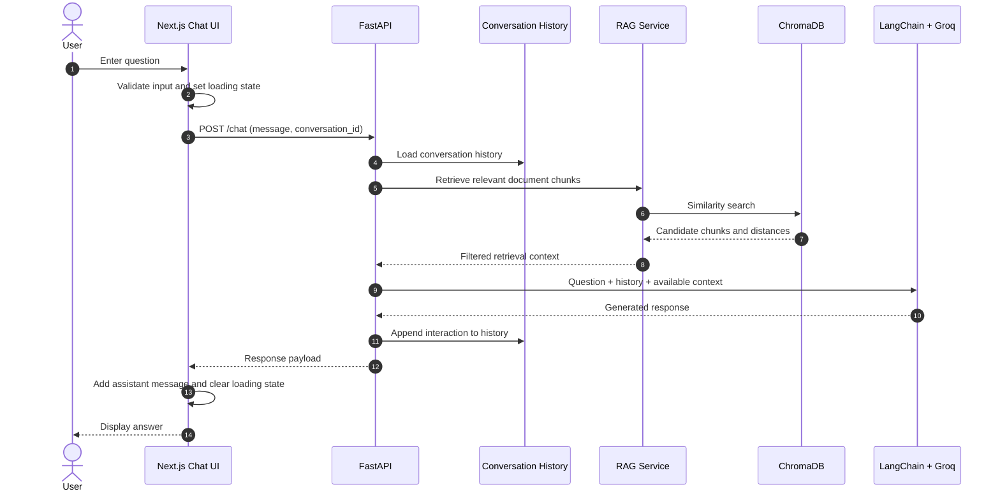
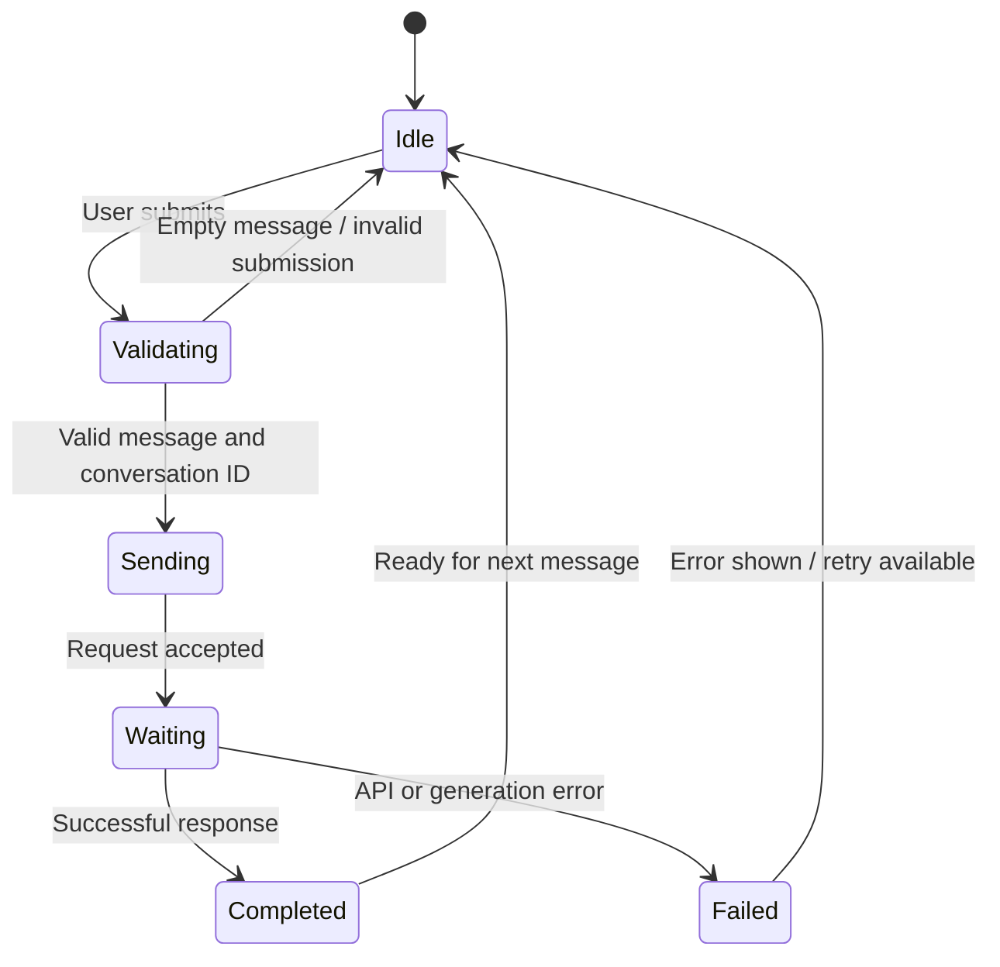
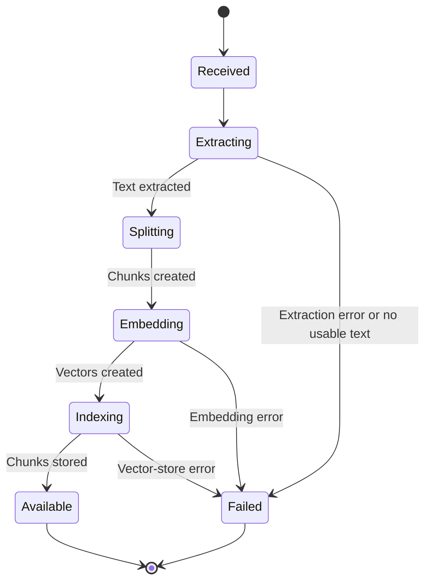
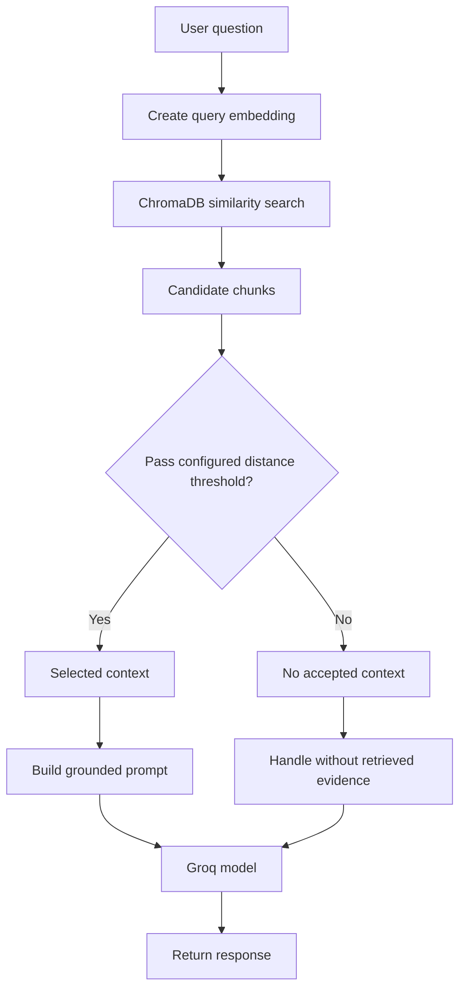

# AskDocs AI

**A bilingual AI chat application with Retrieval-Augmented Generation
(RAG) for querying your own documents.**

[](https://nextjs.org/)
[](https://react.dev/)
[](https://fastapi.tiangolo.com/)
[](https://www.langchain.com/)
[](https://www.trychroma.com/)

> **Project status:** Active development / learning project\
> **License:** Not yet specified

AskDocs AI is a locally runnable, full-stack application. The badges
describe the main technologies; they are not build or release-status
claims.

------------------------------------------------------------------------

## Table of Contents

- [About the Project](#about-the-project)
- [Key Features](#key-features)
- [Technology Stack](#technology-stack)
- [Architecture](#architecture)
- [Project Structure](#project-structure)
- [System Internals and End-to-End Flow](#system-internals-and-end-to-end-flow)
  - [High-Level Component Architecture](#1-high-level-component-architecture)
  - [Document Ingestion Lifecycle](#2-document-ingestion-lifecycle)
  - [Question and Answer Lifecycle](#3-question-and-answer-lifecycle)
  - [Conversation State](#4-conversation-state)
  - [Document Processing States](#5-document-processing-states)
  - [Retrieval and Context Selection](#6-retrieval-and-context-selection)
  - [Failure and Empty-Context Paths](#7-failure-and-empty-context-paths)
- [API Boundary](#api-boundary)
- [Operational Notes and Current Boundaries](#operational-notes-and-current-boundaries)
- [Contributing](#contributing)
- [License](#license)

## About the Project

AskDocs AI is a bilingual (Arabic and English) AI chat application that
combines conversational AI with Retrieval-Augmented Generation (RAG). It
is designed to let users upload supported documents and ask questions
about their contents using natural language.

A general-purpose language model may answer from its training data,
which can be insufficient when a question concerns a specific company
policy, internal manual, or user-provided document. RAG addresses this
by retrieving relevant passages from the user's document collection and
supplying those passages as context to the language model when
generating an answer.

The project brings together a modern web interface, a Python API, an LLM
provider integration, document extraction, multilingual embeddings, and
a persistent vector store.

### Project goals

-   Provide a straightforward chat experience for Arabic and English.
-   Allow users to query information contained in their uploaded
    documents.
-   Ground document-based answers in retrieved content rather than
    relying only on general model knowledge.
-   Keep the frontend, backend, LLM integration, and retrieval
    components modular enough to evolve independently.

## Key Features

-   **Bilingual interaction:** Designed for Arabic and English questions
    and document content.
-   **Conversational chat:** A Next.js interface connected to a FastAPI
    backend.
-   **LLM integration:** Uses LangChain's Groq integration to generate
    responses.
-   **Document-based Q&A:** Retrieves relevant document passages before
    generating RAG answers.
-   **PDF text extraction:** Uses PDF2Text-Arabic for Arabic-oriented
    PDF text extraction; the current processing configuration disables
    OCR fallback.
-   **Multilingual embeddings:** Uses
    `sentence-transformers/paraphrase-multilingual-MiniLM-L12-v2`
    through LangChain Hugging Face integrations.
-   **Vector search:** Stores and searches document embeddings in a
    persistent ChromaDB collection.
-   **Conversation context:** Associates chat requests with a
    conversation ID and uses LangChain message-history support.
-   **Document management UI:** Includes a dedicated documents area in
    the frontend.
-   **API documentation:** FastAPI exposes interactive API documentation
    at `/docs` while the backend is running.

> Supported file types and the exact document-management routes should
> be confirmed against the current backend implementation and its
> `/docs` page.

## Technology Stack

### Frontend

  Technology         Purpose
  ------------------ ----------------------------------------------------
  Next.js 16         React framework, routing, and frontend application
  React 19           Component-based user interface
  TypeScript         Static typing for frontend code
  Tailwind CSS 4     Utility-first styling
  `react-markdown`   Rendering Markdown in chat messages
  `remark-gfm`       GitHub Flavored Markdown support

### Backend and AI

  -----------------------------------------------------------------------
  Technology                          Purpose
  ----------------------------------- -----------------------------------
  Python                              Backend language

  FastAPI                             HTTP API and request handling

  Uvicorn                             ASGI development server

  LangChain Core                      Prompt, runnable, history, and
                                      output-parsing abstractions

  `langchain-groq`                    Groq chat-model integration

  `langchain-community`               Community document loaders,
                                      including text and PDF loaders

  `langchain-huggingface`             Hugging Face embedding integration

  `sentence-transformers`             Multilingual text embeddings

  `langchain-text-splitters`          Splitting extracted documents into
                                      retrieval chunks

  ChromaDB                            Persistent vector database

  `langchain-chroma`                  LangChain integration for Chroma

  PDF2Text-Arabic                     PDF text extraction with
                                      Arabic-oriented layout handling

  pypdf                               PDF processing support
  -----------------------------------------------------------------------

### Storage

-   **ChromaDB:** Persists document chunks and their embeddings in the
    backend's local `chroma_db` directory.
-   **Document files and registry:** The backend has a documents area
    for uploaded files and document metadata. These runtime data files
    are intentionally excluded from source control.

## Architecture

AskDocs AI currently follows a **modular monolithic architecture**: the
frontend and backend are separate applications within one repository,
while the Python backend organizes API handling, RAG services, LLM
integration, conversation history, and schemas into focused modules. It
is not currently presented as a microservices system.

``` text
AskDocs-ai/
├── app/                         # Next.js routes and pages
│   ├── components/               # Reusable UI components
│   ├── documents/                # Document-management page
│   ├── globals.css               # Global styles
│   ├── layout.tsx                # Root application layout
│   └── page.tsx                  # Main chat page
├── public/                       # Static frontend assets
├── backend/
│   ├── llm/
│   │   └── langchain_groq_provider.py  # Groq model, prompts, and chat pipeline
│   ├── memory/
│   │   └── conversation_memory.py      # Conversation-history utilities
│   ├── schemas/                  # Typed request/response and structured-output schemas
│   ├── test/                     # Backend test and evaluation scripts
│   ├── documents/                # Runtime document storage (not committed)
│   ├── chroma_db/                # Runtime vector database (not committed)
│   ├── main.py                   # FastAPI application and API routes
│   ├── rag_service.py            # Extraction, splitting, embedding, and retrieval
│   ├── requirements.txt          # Python dependencies
│   └── .env.example              # Backend environment-variable template
├── .env.example                  # Frontend environment template
├── .gitignore
├── package.json
├── package-lock.json
├── README.md
└── README.ar.md
```

The tree is representative of the cleaned project layout. Runtime
directories such as `chroma_db`, virtual environments, uploaded
documents, and generated caches are not expected to be committed.

### Main modules

-   `app/`: Next.js application routes, pages, and reusable interface
    components.
-   `backend/main.py`: Creates the FastAPI application, configures
    middleware, and exposes application endpoints.
-   `backend/rag_service.py`: Handles document extraction, chunking,
    embedding, vector-store insertion, and retrieval.
-   `backend/llm/langchain_groq_provider.py`: Configures the Groq chat
    model and LangChain prompt/history/output-processing pipeline.
-   `backend/memory/conversation_memory.py`: Provides
    conversation-history support.
-   `backend/schemas/`: Defines structured data models used by the
    backend.
-   `backend/test/`: Contains focused tests and earlier evaluation
    utilities.

## How It Works

### 1. Chat request

1.  A user enters a question in the Next.js chat interface.
2.  The frontend sends the message and a `conversation_id` to the
    FastAPI `/chat` endpoint.
3.  The backend validates the request and obtains the conversation
    context.
4.  The LLM pipeline processes the request and returns a response to the
    frontend.

### 2. Document ingestion

1.  A user uploads a document through the application.
2.  The backend extracts text. PDF processing uses PDF2Text-Arabic with
    OCR fallback disabled in the current configuration.
3.  Extracted text is split into smaller, overlapping chunks.
4.  The multilingual embedding model converts each chunk into a vector
    representation.
5.  Chunks, vectors, and associated metadata are stored in the
    persistent ChromaDB collection.

### 3. RAG question answering

1.  The user asks a question about uploaded content.
2.  The backend converts the question into an embedding using the same
    embedding model.
3.  ChromaDB searches for semantically relevant chunks.
4.  The retrieval layer applies the configured relevance filtering and
    selects context passages.
5.  The LangChain/Groq pipeline receives the question and retrieved
    context.
6.  The model generates an answer, which is returned to the frontend.

``` text
Browser (Next.js)
       |
       | HTTP request
       v
FastAPI (backend/main.py)
       |
       +------ Chat / conversation history
       |
       +------ RAG service
                    |
                    +--> Extract document text
                    +--> Split into chunks
                    +--> Create multilingual embeddings
                    +--> ChromaDB (persistent vector store)
                    |
                    +<-- Retrieve relevant chunks
       |
       v
LangChain + Groq
       |
       v
Generated answer
       |
       v
Browser (Next.js)
```

## System Internals and End-to-End Flow

This section describes how the current application components cooperate, from browser interaction to backend processing, retrieval, and response generation. It focuses on the implemented architecture rather than deployment or installation instructions.

### 1. High-Level Component Architecture

The application is organized as two cooperating runtime processes:

- **Next.js frontend:** owns the user interface, client-side interaction state, and HTTP requests.
- **FastAPI backend:** owns API validation, conversation orchestration, document processing, retrieval, and calls to the language model.
- **ChromaDB:** persists document chunks and their vector embeddings between backend runs.
- **Groq:** provides the chat model used by the LangChain pipeline.
- **Hugging Face Sentence Transformers:** creates multilingual embeddings for both document chunks and user queries.



The diagram shows the logical responsibilities. The document-ingestion path and chat path are separate operations that meet at the persistent vector store: ingestion writes searchable chunks, while chat retrieves them.

### 2. Document Ingestion Lifecycle

Document ingestion transforms an uploaded file into searchable knowledge. The important distinction is that the original file is not sent directly to the language model for every question. It is processed first, and its text chunks are indexed in ChromaDB.



#### Processing stages

1. **Receive:** the frontend sends the selected file to a backend upload endpoint.
2. **Extract:** PDF text is extracted with PDF2Text-Arabic. The current PDF extraction configuration uses `ocr_strategy="never"`; it does not invoke an OCR fallback.
3. **Normalize and represent:** the extracted text is wrapped as LangChain document content with associated metadata.
4. **Split:** `RecursiveCharacterTextSplitter` divides the text into smaller, overlapping chunks. The current RAG configuration uses a chunk size of 500 characters and an overlap of 100 characters.
5. **Embed:** `sentence-transformers/paraphrase-multilingual-MiniLM-L12-v2` converts each chunk into a vector representation.
6. **Index:** `langchain-chroma` writes the chunks, embeddings, and metadata into the persistent ChromaDB collection `company_policy_multilingual`.
7. **Make available:** after successful indexing, the document's chunks can be considered by subsequent retrieval requests.

The diagram uses logical outcomes such as “processing failure” and “available for retrieval.” These describe the lifecycle; they should not be interpreted as a promise that the frontend currently exposes those exact status strings.

### 3. Question and Answer Lifecycle

A user question follows a different path. The backend first determines whether relevant document context can be retrieved, then passes the question and selected context into the LLM pipeline.



#### Retrieval and generation in detail

1. **Request validation:** the `/chat` endpoint receives a message and `conversation_id`.
2. **Conversation lookup:** the backend obtains the message history associated with that conversation identifier.
3. **Embedding the query:** the same multilingual embedding model used during ingestion represents the question as a vector.
4. **Vector search:** ChromaDB returns candidate chunks based on semantic similarity.
5. **Relevance filtering:** the RAG service applies its configured distance threshold and keeps the chunks that pass the filter.
6. **Prompt construction:** the LangChain pipeline builds the model input from the current question, conversation context, and retrieved document context available for that request.
7. **Generation:** the Groq chat model generates the response.
8. **History and response:** the conversation interaction is recorded by the history layer and the API returns the response to the frontend.

### 4. Conversation State

A conversation is associated with a `conversation_id`. The frontend creates and retains this identifier for the active chat session and includes it with chat requests. The backend uses it to load and update the corresponding message history.

The following diagram describes the conceptual state of a single chat submission in the interface:



The interface may also maintain related presentation data, such as the message list, the current input value, and an error message. These are UI concerns; the durable conversation history is managed by the backend history component.

### 5. Document Processing States

At a logical level, each document moves through an ingestion lifecycle. This state model helps explain the expected transitions and where a failure can occur:



These are **conceptual lifecycle states**, not a claim that every state is currently persisted as a database enum. The document registry and UI may expose a smaller set of status values.

### 6. Retrieval and Context Selection

The retrieval layer is the bridge between uploaded knowledge and the language model.



Important design points:

- **One embedding space:** documents and questions use the same multilingual embedding model, which makes their vectors comparable.
- **Retrieval precedes generation:** the model receives retrieved passages as context; ChromaDB itself does not generate natural-language answers.
- **Threshold filtering:** vector search candidates are not automatically treated as relevant. The RAG service applies its configured distance threshold.
- **Context availability matters:** when no chunks pass filtering, the model has no accepted document evidence for that request. The response should not be interpreted as a document-grounded answer.

### 7. Failure and Empty-Context Paths

The system has several boundaries where an operation can fail. Keeping these paths explicit makes debugging and future hardening easier.

| Stage | Example condition | Expected handling area |
|---|---|---|
| Frontend validation | Empty message or missing conversation identifier | Chat UI |
| HTTP request | Backend unavailable or request rejected | Frontend error handling / FastAPI |
| File upload | Unsupported or invalid file | Upload endpoint |
| Text extraction | PDF contains no extractable text or extraction fails | Document-processing service |
| Chunking / embeddings | Processing or model error | RAG service |
| Vector indexing | ChromaDB write fails | RAG service |
| Retrieval | No candidates or no candidates pass the threshold | Retrieval and prompt logic |
| LLM generation | Provider error, timeout, or invalid model response | LangChain/Groq integration |

A successful HTTP response does not, by itself, prove that an answer is supported by a document. For document-grounded use cases, evaluate the retrieved context as well as the generated text.

## API Boundary

FastAPI is the backend's HTTP boundary. The chat route currently used by the frontend is:

`POST /chat`

Example request:

```json
{
  "message": "What is the annual leave policy?",
  "conversation_id": "example-conversation-id"
}
```

The backend expects the user's message and a conversation identifier. The exact response structure and all document-management routes should be read from the running FastAPI OpenAPI specification:

```text
http://127.0.0.1:8000/docs
```

This keeps the README from duplicating or guessing route names and response fields that may change as the API evolves.

## Operational Notes and Current Boundaries

- **PDF extraction:** the current PDF extraction path uses PDF2Text-Arabic with OCR disabled. Scanned PDFs that contain no extractable text may therefore require a separate OCR capability in a future iteration.
- **Persistence:** ChromaDB data is stored locally under the backend runtime directory. Back up this directory if the indexed collection must be preserved.
- **Embeddings:** changing the embedding model for an existing collection requires a planned re-indexing strategy. Vectors created by different embedding models should not be mixed in the same retrieval space.
- **Conversation history:** the current implementation uses LangChain's message-history integration. Review its persistence and lifecycle behavior before deploying multiple backend workers.
- **Security:** before exposing the application to untrusted users, add authentication and authorization, upload validation and size limits, rate limiting, secure secret management, and production CORS settings.
- **Source-grounding:** generated answers can be incorrect. Important decisions should be checked against the original document passages.

## Contributing

Contributions, bug reports, and suggestions are welcome.

1. Fork the repository.
2. Create a focused branch:

   ```bash
   git checkout -b feature/your-feature
   ```

3. Make your changes and keep them scoped.
4. Run the relevant frontend and backend checks.
5. Commit with a clear message:

   ```bash
   git commit -m "Add: describe your change"
   ```

6. Push your branch and open a Pull Request describing the problem, the changes, how they were tested, and any configuration impact.

Do not include API keys, private uploaded documents, local vector-store data, or virtual-environment folders in contributions.

## License

No license has been specified for this repository yet. Until a license file is added, do not assume that the project is available for unrestricted reuse, redistribution, or modification.

If you intend to publish the project as open source, choose a license (for example, MIT) and add the corresponding `LICENSE` file before describing the project as MIT-licensed.
